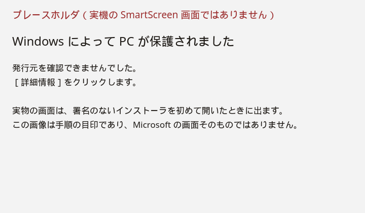
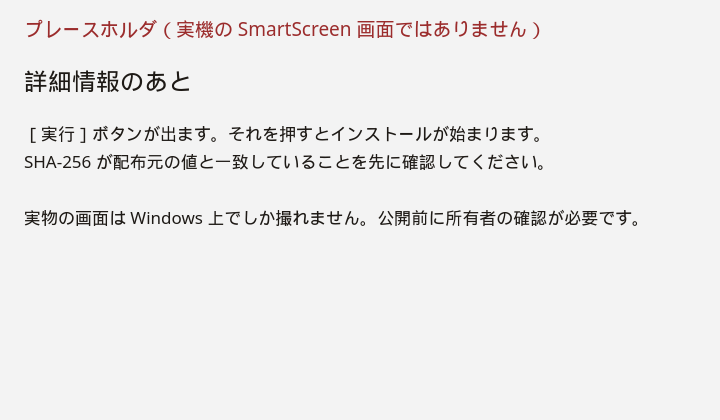
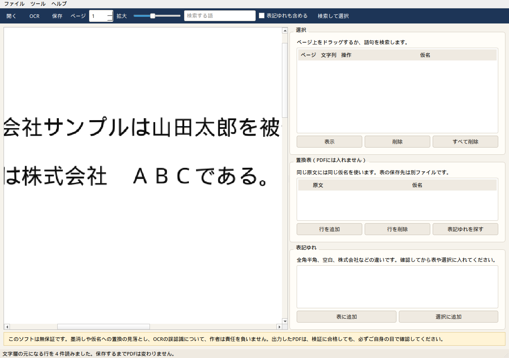
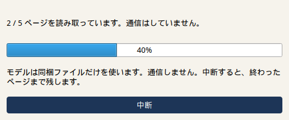
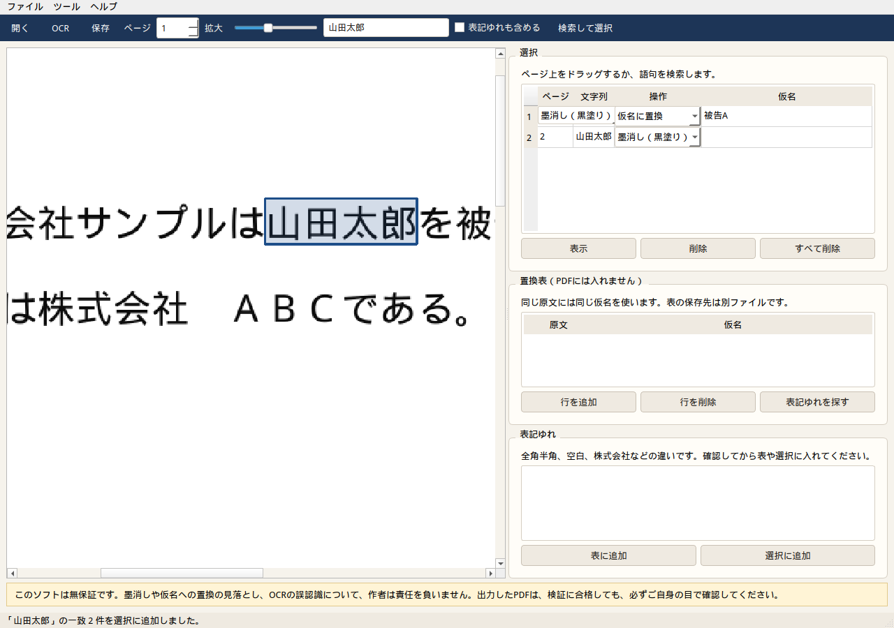
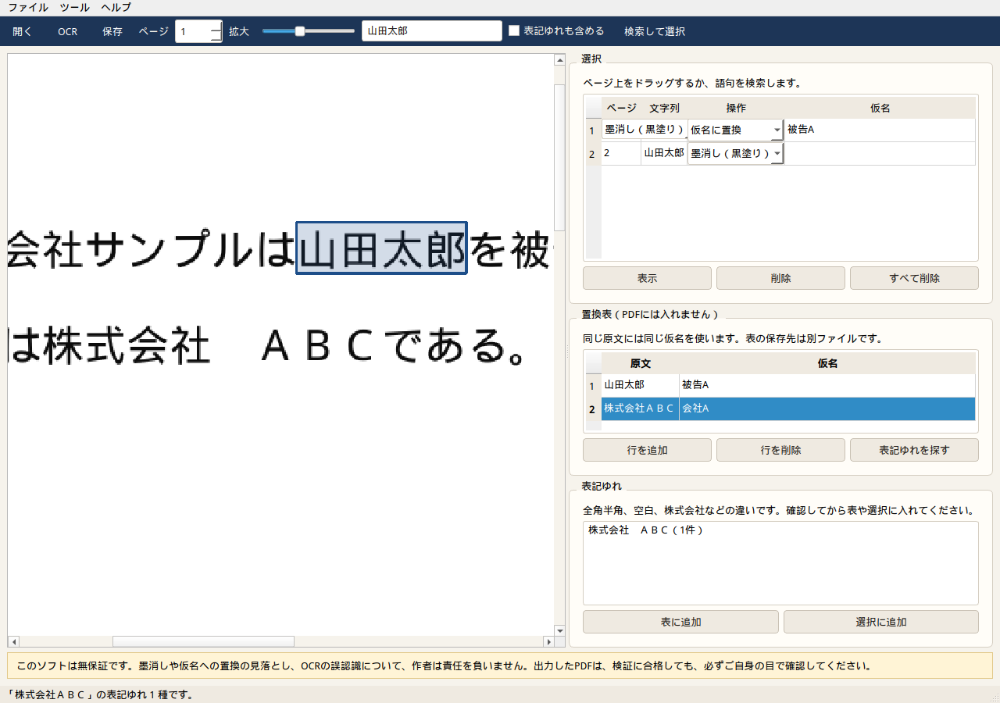
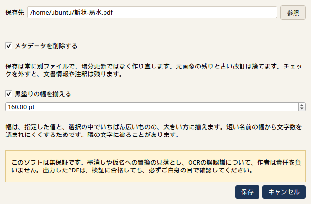
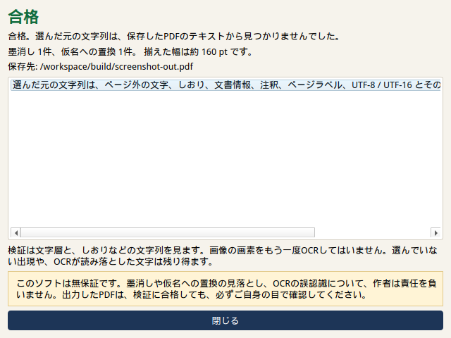
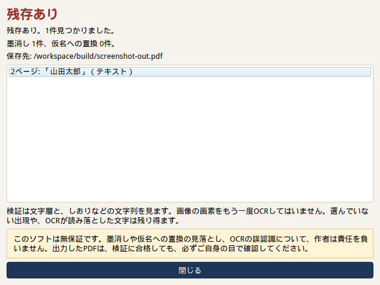

# 易水PDF（ekisui-pdf）

スキャンしたPDFに、手元のOCRで透明な文字層を乗せ、必要なところを本当に墨消しするか仮名に置き換えて、別名で保存する Windows アプリです。易水会の勉強会に来てくれた人へのお礼として配る想定です。

事件記録を外に出さないため、**実行中は通信しません。** OCRのモデルはアプリに入っています。

## 無保証

**作者は、墨消しや仮名への置換の見落とし、OCRの誤認識、その結果について、一切責任を負いません。**

検証に合格しても、画素の消し残しや、選んでいない表記は残り得ます。出力したPDFは、必ず自分の目で確認してください。このソフトの結果だけを根拠に、提出用の書面ができたと思わないでください。

## 動作環境

- Windows 10 / 11（64ビット）
- インストール先はユーザーのフォルダです。管理者権限は要りません
- インストーラは署名していません

## インストール

1. GitHub Actions のアーティファクト `ekisui-pdf-windows-installer` から `ekisui-pdf-0.1.0-win64-setup.exe` を受け取ります。公開リリースは、画面を確認するまで作りません。
2. 下の手順で SHA-256 を確認します。
3. インストーラを実行します。スタートメニューに「易水PDF」と「アンインストール」が入ります。
4. ライセンスと第三者表記は、インストール先の `THIRD_PARTY_NOTICES.md` と `licenses` フォルダにあります。

### SmartScreen

署名がないので、初回は「Windows によって PC が保護されました」と出ます。

1. **詳細情報** を開く
2. **実行** を押す

下の2枚は、その操作の目印です。**Microsoft の画面そのものではなく、プレースホルダです。** 実物は公開前に、このリポジトリの所有者のPCで確認してください。





### SHA-256 の確認

インストーラと同じ場所にある `SHA256SUMS.txt`、または Actions のジョブ要約にある値と比べます。

コマンドプロンプト:

```bat
certutil -hashfile ekisui-pdf-0.1.0-win64-setup.exe SHA256
```

PowerShell:

```powershell
Get-FileHash .\ekisui-pdf-0.1.0-win64-setup.exe -Algorithm SHA256
```

大文字小文字の違いは無視してかまいません。1文字でも違ったら実行しないでください。

## 使い方

1. **開く** でスキャンPDFを開きます。ページはホイールでスクロール、Ctrl+ホイールかスライダで拡大します。
2. **OCR** を実行します。ページごとに進み、中断できます。ここまでで、文字層だけの保存もできます。
3. 範囲は、ページ上のドラッグか、語句の検索で選びます。一覧でページへ移動し、不要な行は削除できます。
4. 各選択を **墨消し（黒塗り）** か **仮名に置換** にします。仮名は選択の欄か、置換表から取ります。同じ原文には同じ仮名を使います。
5. **表記ゆれを探す** で、全角半角、空白、`株式会社` などの違いを一覧します。確認してから表や選択に追加します。自動では消しません。
6. **名前を付けて保存** します。元のファイルは上書きしません。置換表をPDFに入れることはありません。残すなら「置換表を保存」で JSON か CSV を別ファイルにします。
7. 保存直後に、選んだ元の文字列がテキストに残っていないかを再オープンして調べ、合格か残存かを出します。















保存オプション:

- **メタデータを削除する**（初期値はオン）。文書情報、XMP、添付、JavaScript、注釈、サムネイルを落とします。
- 保存は常に、増分更新ではなく作り直しです。参照されなくなった元画像と、古い改訂は捨てます。
- **黒塗りの幅を揃える**。指定した幅と、選択の中でいちばん広いものの、大きい方に揃えます。短い名前の幅から文字数を読まれにくくします。隣の文字に被ることがあります。

墨消しは、黒い四角を上に描くのではありません。PyMuPDF の `apply_redactions` で、重なった画像の画素と文字を消します。仮名は、消したあとの黒い枠に白い文字として書き、検索すると仮名の方に当たります。

## OCRの方式

PaddleOCR の **PP-OCRv5** です。認識モデルは日本語を含みます。実行は **ONNX Runtime（CPU）** で、RapidOCR 3.10 からそのモデルだけを読みます。

PaddlePaddle 自体は同梱していません。Windows の CPU 版はホイールが重く、PyInstaller での同梱が壊れやすいためです。使っている重みは PP-OCRv5 の mobile（検出 `ch_PP-OCRv5_det_mobile`、認識 `ch_PP-OCRv5_rec_mobile`）で、RapidOCR が配布している ONNX です。RapidOCR 3.10 の初期値は PP-OCRv6 なので、起動時に v5 とローカルファイルのパスを明示しています。パスが無いときの自動ダウンロードは使いません。さらに、Python からの外向き接続と `requests` を起動時に拒否します。

向きの自動補正（180度分類）は入れていません。RapidOCR の分類器と、v5 の textline 向きモデルは別物で、誤った分類器を同梱するとページを壊すためです。ページは正立させてください。

この環境（Linux、4コアの Intel Xeon、200 dpi、12行のA4を1ページ）では、モデル読み込みのあと **1ページあたり約0.9秒** でした。Windows の実測は、Actions の Windows installer ジョブのログに出ます。

## 既知の制限

- 検証は、ページの外にはみ出した文字、しおり、文書情報、注釈、ページラベル、UTF-8 / UTF-16 と、その16進表記を見ます。画像の画素をもう一度OCRしてはいません。
- 墨消しの位置は、OCRが返す文字ごとの矩形を隣の文字との中点まで広げたものです。等幅で割った位置は使いません。縦書きは行が縦長のときだけ、同じ考え方で縦に広げます。
- 保存時にOCR結果がある場合は、スキャンに最初から付いていた文字層を画像の画素を残したまま消してから、今回の文字層を書き直します。
- 墨消しをした保存では、ページのサムネイルも落とします。文書情報の削除をオフにしていても残しません。
- 別のPDFを開くと置換表は空になります。前の事件の仮名を残さないためです。
- OCRが読み間違えた字は、検索しても出てきません。
- パスワード付きPDFは開けません。
- 固定幅にすると、隣の文字の画素まで黒くなることがあります。
- 仮名は黒い枠の中の白文字です。
- 対応するのは Windows 10/11 64ビットです。中核のテストは Linux でも走ります。

## 開発

```bash
python -m venv .venv
. .venv/bin/activate
pip install -e ".[dev]"
python scripts/fetch_models.py
pytest
python -m ekisui_pdf
```

モデルの URL と SHA-256 は `models/manifest.json` です。onnx ファイル自体は git に入れません。

Windows のインストーラは `.github/workflows/windows-installer.yml` が `windows-latest` で作ります。PyInstaller の onedir を Inno Setup で包み、アーティファクトと SHA-256 を出します。UPX は使いません。

画面写真の撮り直し:

```bash
python scripts/capture_screens.py
```

## ライセンス

GNU AGPL-3.0 です。PyMuPDF が AGPL のため、アプリ全体を AGPL-3.0 にしています。ソースは https://github.com/aquariumyossy/Ekisui-pdf です。

第三者表記は [THIRD_PARTY_NOTICES.md](THIRD_PARTY_NOTICES.md) です。
