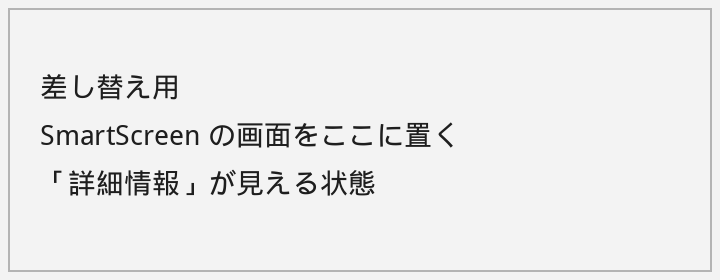
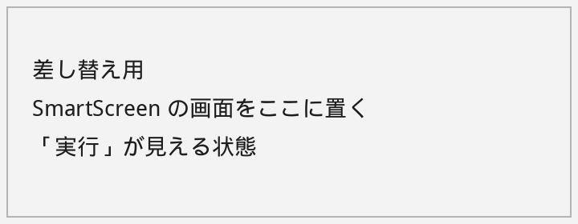

# ekisui-pdf

日本語の法律文書 PDF を、そのパソコンの中だけで墨消しする Windows アプリです。易水会の勉強会で配ることを想定しています。通信はしません。OCR も墨消しも、開いた PDF も、外には出ません。

ライセンスは **AGPL-3.0** です。PDF の処理に PyMuPDF を使っているため、アプリ全体をこのライセンスで配布します。`LICENSE` と `THIRD_PARTY_NOTICES.md` を同梱しています。

## 免責

このソフトには保証がありません。作者は、消し残し、誤った墨消し、OCR の読み間違い、その他このソフトを使った結果について、一切責任を負いません。

墨消しは人が確認するものです。保存のあと画面に「消した語句は見つかりませんでした」と出ても、それだけで安全ではありません。出力した PDF を自分の目で読み、必要な箇所が消えているか確かめてください。迷ったら、そのファイルを提出しないでください。

## 動作環境

- Windows 10 または Windows 11（64 ビット）
- インストール先はユーザーのフォルダです。管理者権限は要りません
- 実行中にインターネットは使いません。OCR のモデルはインストーラに入っています

縦書き、手書き、JPEG や TIFF の単体画像は、この版の対象外です。対象は、横書きのスキャン PDF と、すでに文字が入っている PDF です。

## インストール

1. 配布された `ekisui-pdf-0.1.0-win64-setup.exe` の SHA-256 を、下の手順で照合する
2. インストーラを実行する
3. スタートメニューの「ekisui-pdf」から起動する

署名は付けていません。初めて実行すると Windows の SmartScreen が警告します。

1. 「Windows によって PC が保護されました」と出たら **「詳細情報」** を押す
2. アプリ名を確認して **「実行」** を押す





上の2枚は差し替え用の枠です。実際の警告画面の画像は、配布前に撮ってこのファイル名で置き換えてください。

### SHA-256 を確認する

PowerShell で、インストーラを保存したフォルダに移動して次を実行します。

```powershell
Get-FileHash .\ekisui-pdf-0.1.0-win64-setup.exe -Algorithm SHA256
```

表示されたハッシュが、配布元の一覧と一致することを確認してください。GitHub Actions の `installer` ジョブのログにも、同じ `Get-FileHash` の結果が出ます。アーティファクト名は `ekisui-pdf-0.1.0-win64-setup` です。

このリポジトリは非公開のままです。リリースは作っていません。画面を確認してから公開するかどうか決めてください。

## 使い方

1. **開く** で PDF、または Word（.doc / .docx）を開く。Word は、この PC に入っている Microsoft Word で PDF に変換してから表示します。コメントと変更履歴の印は含めず、文書のプロパティも消します。元の Word ファイルは変更しません。Word が無いときは、その旨を表示して止まります。変換した PDF は文字データなので、OCR は不要です。ページの縮小版と、拡大縮小できる本文が出ます。この時点ではマスキング候補は作りません。マウスホイールとタッチパッドのスクロールは、ページの下端を越えると次のページへ続きます。Ctrl+ホイールとピンチは拡大縮小のままです
2. スキャンは **OCR実行** で文字を読み、検索できる PDF にします。マスキングはしません。読み取りが終わると、右のペインは **OCR修正** に切り替わります。すでに文字がある PDF は、このボタンを押さなくても次へ進めます。▾ で **自動傾き補正** を切れます（初期値はオン）。向きや傾きを直したページは、その画像のまま保存されます。直した量はサムネイルに出ます
3. 読みが怪しい行は **OCR修正** タブで、行をクリックして直す。Enter で確定、Esc で取消です。欄がページの端に近いときは、欄と **確定** が画面の中に収まるように動きます
4. **マスキング実行** で、電話番号、メール、口座番号、郵便番号、住所、英数字、人名を右の一覧に出します。確定はしません。スキャンでまだ読んでいないページは、先に OCR してから候補を出します。もう一度押すと、手で足した語句と範囲は残して候補を探し直します。OCR修正の **探し直す** も同じです
5. 一覧の検索欄（Ctrl+F）と **範囲で選ぶ** で、候補を足せます。マスキング実行の前でも後でも使えます。空白や改行、全角と半角、読み間違いやすい字は揃えてから探します
6. 各候補は **黒塗り** か **置換** です。人名と会社は置換、電話・メール・口座・郵便は黒塗りが初期値です。都道府県から始まる住所は、市区町村が続くときは置換で、呼び名は住所A、住所Bです。丁目とハイフンは同じ住所として一つの呼び名になります。知事や府警など機関の名前、都道府県だけのときは、候補のまま初期値は黒塗りです。呼び名は会社A、個人甲、住所Aのように自動で付き、同じ語句は全ページで同じ呼び名になります
7. 選んだ枠の左右をドラッグすると、範囲を1文字ずつ変えられます。右クリックで自動の範囲に戻せます。直した枠には「手動」と出ます
8. **置換表** で表記ゆれをまとめられます。住所の節もあります。黒塗りの候補は表に出ません。置換表は PDF には入りません。保存するときは別ファイルです
9. 右下の **確定…** は、一覧・置換表・OCR修正のどれを開いていても押せます。選んだ範囲の画像の画素と文字を、そのセッションのページに焼き付けます。黒い四角を上に描くだけではありません。確定した文字と画素は、その後に範囲を足しても、ページを変えても、拡大しても、読み取り直しても戻りません。新しい範囲は、消したあとのページに足します。置換は、消したあとに呼び名を書き込みます。**枠の幅をそろえる**（初期値オン）は、短い語句の枠をおよそ5文字分まで広げます。長い語句は短くしません
10. **保存** は必ず別名です。元のファイルは上書きしません。同じ名前があるときは「 (2)」「 (3)」を足します。マスキングを確定したあとは `（元の名前）_Masked.pdf` で、消し残りも確認します。記録と置換表の CSV は、その名前に続きます。読み取りだけで確定していないときは `（元の名前）_OCR.pdf` です。マスキングはしません。候補が残っているときは、OCRだけ保存するか、確定に進むかを選べます。読み取りも確定もまだない文字 PDF では、保存は押せません
11. マスキングして保存した直後に、保存したファイルを開き直し、消したはずの語句が残っていないかを同じルールで探します。残っていれば一覧と移動ボタンが出ます。手で縮めた枠は、縮めたあとの文字だけを探します

画面の説明は、ボタンにマウスを乗せたときに出ます。

## OCR

PaddlePaddle を Windows に同梱するのは、CPU 用の依存関係と PyInstaller での配布が不安定なため見送りました。認識に使う重みは PP-OCRv5 の mobile モデル（検出・認識・行の上下判定）で、実行は ONNX Runtime の CPU だけです。認識モデル `ch_PP-OCRv5_rec_mobile` は中国語・英語に加えて日本語を学習したモデルです。日本語専用の PP-OCRv5 認識モデルは配布されていません。

モデルの入手元とハッシュは `models/SHA256SUMS` と `THIRD_PARTY_NOTICES.md` にあります。起動時にモデルを取りに行く処理はありません。

## 開発

```powershell
python -m pip install -e ".[dev]"
python tools/verify_models.py
python -m pytest
```

テストは、日本語を画像にしたスキャン風 PDF（傾いたページを含む）で、文字レイヤ、傾き補正、画素の削除、呼び名、メタデータ、表記ゆれ、消し残しの検出を確認します。通信しないことも、ソケットを塞いだ状態で OCR を読み込んで確認します。

画面は PySide6 です。オフスクリーンのスクリーンショットは `docs/screenshots/` にあります。

## 既知の制限

- Word の墨消しは、変換した PDF に対して行います。docx の中身を直接塗りつぶす機能はありません。変換には Windows 上の Microsoft Word が必要です。マクロは止めます。文書が外部の画像を参照しているとき、その取得は Word 側で行われることがあります
- 検証は保存後の文字レイヤとメタデータを見ます。画像の中の文字をもう一度 OCR して探す処理ではありません
- ページ面積の約6割以上を、4千画素以上の画像が占めるとき（ページの回転を反映し、分割された画像は合わせて数えます）はスキャンとして読み直します。ファクスヘッダやページ番号など、見えている文字も残し、画像から読んだ文字と合わせて検索します。傾きは画像と見えている文字に同じ回転を掛けます。複合機の見えない文字層は残しません。保存するページは直した画像から作るので、枠の中では画素と文字の両方が消えます。OCR の前に保存しようとすると、読み取ってから保存するよう止めます。画像がページの大半を占めない文字だけのページは、短くてもその文字を使います。画像の無い空白ページはそのまま保存できます
- 文字の位置は、テキストPDFでは文字ごとの箱、スキャンでは文字幅で置きます。全角（全角スペースを含む）は1、半角は0.5、ASCIIの空白はそれより狭く数えます。検証は語句全体に加えて、8文字以上の語句の前半と後半が残っていないかも見ます。画像をもう一度 OCR する検証ではありません
- 半角カタカナの濁点（ﾀﾞ など）と、段組で横に並んだ行は、取りこぼすことがあります
- 検出器はページの長辺を960ピクセルに縮小してから文字の位置を探します。ごく小さい文字は拾えないことがあります
- 人名の下の名前がひらがなだけの場合（山田たろう）はマスキング実行の候補にしません。語句検索は使えます。役職のあとの氏名は、印のノイズや次の短い行に名前が分かれていても候補にします
- マスキング実行は行の中だけを見ます。行をまたいだ電話番号は拾いません。語句検索は、近い行の折り返しはつなぎます
- 英数字の候補は、英字を1字以上含む3文字以上です。数字だけの列は口座や電話の規則に任せます。初期状態ではチェックが外れています
- 読み間違いやすい字（フとプなど）の候補は、マスキング実行でも最初から選択されます。それ以外のゆるい一致は、語句検索で出します
- 都道府県で始まる文字列は、すべて最初からチェックされた候補です。市区町村が続く住所は住所Aのように置換し、知事・警察・議会などの機関名と、都道府県だけのときは黒塗りです。住所の続きが長いときは、建物名まで枠に入ることがあります
- 枠の幅をそろえても、長い名前の枠は短くなりません。長さから名前を推測される余地は残ります
