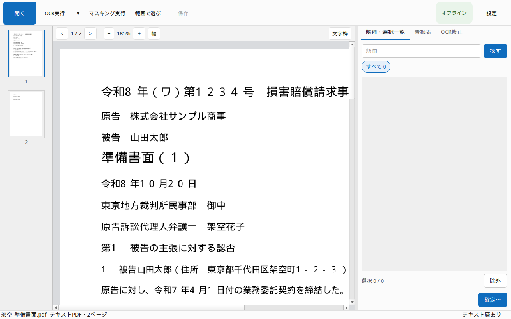
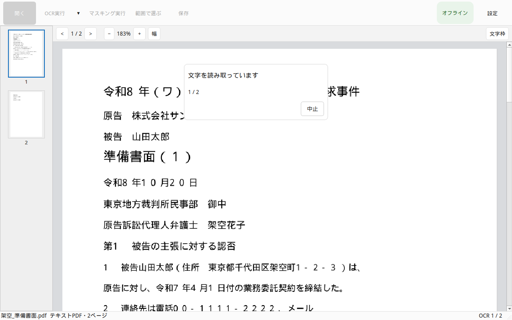
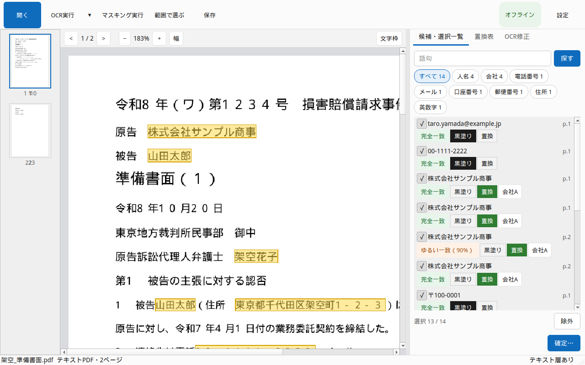
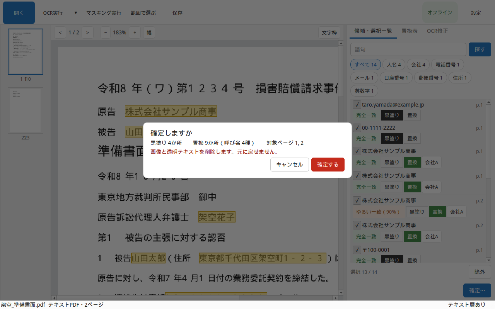
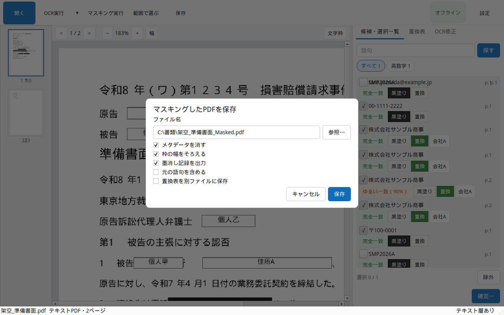

# 使い方ガイド

## はじめに

ekisui-pdf は、このパソコンの中だけで、日本語の法律文書を黒塗りしたり、呼び名に置き換えたりするアプリです。インターネットにはつなぎません。

候補は自動で出ます。出たものを、人が必ず目で見ます。チェックが付いたまま確定すると、その箇所が消えます。チェックを外したままにすると、残ります。

消し忘れることが、いちばん危険です。画面に「消した語句は見つかりませんでした」と出ても、それだけで安全ではありません。保存した PDF を自分で読み、必要な箇所が消えているか確かめてください。迷ったら、そのファイルは出さないでください。

試しに使うファイルは、インストールしたフォルダの `samples` にあります。`架空契約_スキャン.pdf` は画像だけなので、OCR実行から試せます。`架空契約_テキスト.pdf` は文字が入っています。どちらも架空のデータです。保存は、そのファイルの横に新しい名前でできます。このフォルダは自分のユーザーフォルダの中なので、そのまま保存できます。アンインストールすると見本は消えます。自分で保存したファイルは残ります。

## 5ステップで使う

### 1. 開く

**開く** で、PDF か Word（.doc / .docx）を選びます。ページの縮小版と本文が出ます。この時点では、まだ候補は出ません。初めてなら、`samples` フォルダの `架空契約_スキャン.pdf` を開いてください。

### 2. OCR実行

スキャン画像の PDF は、**OCR実行** で文字を読みます。マスキングはしません。読み終わると、右の画面は **OCR修正** に切り替わります。

すでに文字が入っている PDF は、このボタンを押さなくてよいです。

### 3. マスキング実行

**マスキング実行** で、人名や電話番号などの候補が右の一覧に出ます。まだ消しません。

スキャンで読んでいないページは、先に文字を読んでから候補を出します。

### 4. 確認して確定

一覧を見て、消すものにチェックを付けます。人名や会社は呼び名への置き換え、電話やメールは黒塗りが最初の状態です。

右下の **確定…** で、選んだ箇所の画像と文字を消します。消したあとは、その文字は戻りません。

### 5. 保存

**保存** は、別の名前で保存します。元のファイルは上書きしません。

マスキングのあとは `名前_Masked.pdf` です。読み取りだけのときは `名前_OCR.pdf` です。同じ名前があるときは「 (2)」が付きます。

保存の直後に、消したはずの語句が残っていないかを探します。残っていれば、一覧からその場所へ移れます。

## 困ったとき

### 読み取りを直す

右の **OCR修正** で、行をクリックして直します。Enter で確定、Esc で取消です。

直した行は、候補と **置換表** に反映されます。直す前の候補は残ります。新しくできた候補は、チェックが外れた「要確認」です。それを見るまで、確定はできません。

確定済みのページは、文字も画像も消してあるので、直せません。

### 範囲を直す

候補の枠の左右をドラッグすると、範囲を1文字ずつ動かせます。

Enter、Esc、またはページの空白をクリックすると、枠のつまみは消えます。動かした範囲はそのまま残ります。Esc では元に戻りません。

自動の範囲に戻すときは、枠を右クリックして **自動の範囲に戻す** を選びます。

### 候補を足す

**範囲で選ぶ** で、ページ上をドラッグします。一覧の検索欄（Ctrl+F）に語句を入れて探すこともできます。マスキング実行の前でも後でも使えます。

### 表記のゆれ

**置換表** で、同じ呼び名にまとめます。黒塗りの候補は表に出ません。置換表は PDF には入りません。保存するときは、別の CSV です。

### マスキングの設定

右上の **設定** で、「マスキングの設定」が開きます。

読み取りのゆれを、どこまで同じ語句とみなすかを変えられます。数字を下げると、少し違う表記まで拾います。要確認にする自信の低さも、ここで変えます。短い枠を広げる最小の幅も、ここで変えます。長い枠は縮みません。

### Word ファイル

Word を開くには、このパソコンに Microsoft Word が入っている必要があります。コメントと変更履歴の印は、変換した PDF に入れません。文書のプロパティは消します。マクロは実行しません。元の Word ファイルは変更しません。

docx の中を直接塗る機能はありません。塗るのは、変換した PDF です。

## 注意点

次のときは、候補から漏れることがあります。漏れたものは、自分で探して足してください。

- 縦書き、手書き、JPEG や TIFF の1枚画像は、対象外です。対象は、横書きのスキャン PDF と、文字が入っている PDF です。
- 名前の下がひらがなだけ（山田たろう）のときは、マスキング実行の候補にしません。検索欄から探せます。
- 行をまたいで折り返した語句は、同じ段の次の行や、次のページの本文の先頭も、一つの語句として塗ります。別の段や表の隣のマス、空行のあとにはつなぎません。
- 半角カタカナの濁点（ﾀﾞ など）や、段組で横に並んだ行は、取りこぼすことがあります。
- とても小さい文字は、拾えないことがあります。
- 英字を含む3文字以上だけが、英数字の候補です。数字だけは、電話や口座の規則に任せます。英数字の候補は、最初はチェックが外れています。
- フとプのように読み間違いやすい字は、最初からチェックが付きます。それ以外の少し違う表記は、検索で出します。
- 都道府県から始まる文字列は、候補になります。市区町村が続く住所は、住所Aのように置き換えます。知事や警察などの機関名と、都道府県だけのときは、黒塗りです。住所が長いと、建物名まで枠に入ることがあります。都道府県で終わる行の次に番地だけがあるときは、一つの住所になりません。検索欄から足せます。
- 短い枠を広げても、長い名前の枠は縮みません。枠の長さから、元の語句を推測される余地は残ります。
- 手で枠を縮めたあとは、縮めたあとの文字だけを、消し残りの確認で探します。
- 保存後の確認は、文字とファイル情報を見ます。行をまたいだ続きも探します。行の先頭に残った「ー」のような続きは、消し残りに出ます。画像の中の文字を、もう一度読んで探す処理ではありません。
- ページの大半が画像のときは、スキャンとして読み直します。ファクスの見出しやページ番号も、検索の対象に残します。複合機が付けた見えない文字は残しません。
- スキャンのページは、文字を読む前には保存できません。文字だけの短いページは、その文字を使います。画像の無い空白ページは、そのまま保存できます。

Word については、次も注意してください。

- 権利管理（IRM）の文書は、開かないでください。ファイルから分かるときは開きません。分からないときは、Word が確認のために外へ接続することがあります。
- Word 自身の更新確認、アドイン、ネットワーク上のひな形、割り当て済みドライブ（Z: など）の .doc は、このアプリから完全には止められません。
- 外部の画像や文書、ひな形を外せないときは、開かずに止まります。ファイルの中に保存されていない画像は、変換した PDF には出ません。取りには行きません。
- HTML や RTF は変換しません。
- 文書の中のリンクは開きません。変換した PDF のリンクも消します。

## よくある質問

### 元のファイルは変わる？

変わりません。保存は必ず別名です。確定で消えるのは、開いている作業用のページです。

### 保存した後に消し残りを確認するには？

保存の直後に、自動で探します。残っていれば一覧が出ます。そのあと自分の目でも読んでください。自動の確認だけでは、安全とは言い切れません。

### インターネットは使う？

使いません。読み取りもマスキングも、このパソコンの中で行います。

### 置換表CSVは何？

呼び名と、元の語句の対応表です。PDF とは別に保存します。元の語句を入れると、その CSV も機密になります。必要なときだけ出してください。
